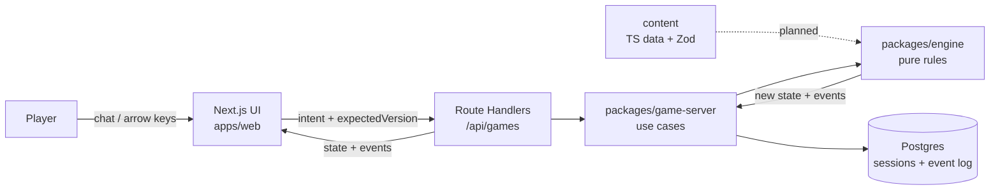

# Architecture

Grunberg is a TypeScript monorepo. Game rules live in one pure engine, the server is the single source of truth, and the UI only renders state and sends player intents.

> Sections marked **Implemented** describe the code as it is. Sections marked **Planned** describe the agreed design for features that do not exist yet.

## Overview (Implemented)

| Layer                  | Responsibility                                                                                                                                                                               |
| ---------------------- | -------------------------------------------------------------------------------------------------------------------------------------------------------------------------------------------- |
| `packages/engine`      | Pure game rules: `applyAction(state, action, ctx) → { state, events }`. No I/O, no React; the clock is injected (`ctx.now`). Also holds the shared types, character rules and `gameStateSchema`. |
| `packages/game-server` | Framework-agnostic use cases (`createGame`, `getGame`, `getEvents`, `performIntent`), domain errors, Zod schemas for requests, Postgres access (Drizzle), rate limits and retention.            |
| `apps/web`             | Next.js app: UI routes (`/`, `/new`, `/game`) and thin Route Handlers under `/api/games` that call `game-server`.                                                                           |



### Request flow

1. The client sends an **intent**, never a state change: `{ expectedVersion, intent: { type: "move", direction: "east" } }`.
2. `readJson` (`apps/web/src/server/request.ts`) checks the origin, the content type (`application/json`) and the body size (16 KB), parses the JSON and validates it with the Zod schema.
3. `performIntent` loads the game, rejects a stale `expectedVersion` (`409` with the current game) and turns the intent into an engine action (`intentToAction`). Illegal intents, like walking into a wall, are rejected (`422`).
4. The engine computes the new state and events. The repository saves both in one transaction, guarded by `WHERE version = expectedVersion`.
5. `handle` (`apps/web/src/server/http.ts`) maps domain errors to HTTP status codes in one place. Anything unexpected surfaces as a logged `500`.

Security details (origin and size checks, rate limits, headers, retention) are described once, in the README section "Security model".

## State ownership (Implemented)

- **API games:** the server is authoritative. A client can only ask for an intent, so it cannot add items or gold.
- **In the browser:** `createGameStore` (`apps/web/src/core/gameStore.ts`) runs the same engine locally. Components never touch the store directly; they use hooks:
  - `useGameState()` returns the current state (via `useSyncExternalStore`, server-render safe);
  - `useGameActions()` returns stable actions (`createCharacter`, `loadState`, `resetState`).
- **Why a store instead of React Context with `useReducer`:** every `dispatch` applies the action to the latest state and emits its events immediately, so React batching cannot drop events. Actions without effect do not re-render anything.
- **Local saves:** `useAutoSave` writes the state to localStorage (debounced). Saves and imported files are validated with `gameStateSchema` before they reach the game.

> The game screen does not call the API yet. Connecting it (TanStack Query, optimistic updates, rollback on `409`/`422`) is the next roadmap item.

## Events (Implemented)

The engine returns events as plain data instead of emitting them:

```ts
import { applyAction, createInitialGameState } from "@grunberg/engine";

const now = Date.now();
const { state, events } = applyAction(
  createInitialGameState(now),
  { type: "UPDATE_CURRENCY", payload: { type: "gold", amount: 50 } },
  { now },
);
// state.inventory.currency.gold === 50
// events: [{ type: "CURRENCY_CHANGED", data: { type: "gold", amount: 50 } }]
// The event reports the amount that actually changed: spending more gold than
// the player has clamps gold at 0, and the event reports the real difference.
```

- On the server, events are stored in the append-only `game_events` table, which makes a session replayable and debuggable.
- In the browser, the store publishes them on `gameEventBus` (`apps/web/src/core/GameEventBus.ts`), so systems like quests or sound can react without knowing about each other.

Systems that listen to events stay decoupled: a quest system only cares that `ENEMY_DEFEATED` happened, not how combat works.

## Persistence and retention (Implemented)

| Table           | Contents                                                                     |
| --------------- | ---------------------------------------------------------------------------- |
| `game_sessions` | game state (`jsonb`), `version` for optimistic locking, `updated_at`         |
| `game_events`   | append-only event log per session (deleted with the session)                 |
| `rate_limits`   | global fixed-window counters per rule (e.g. `create-game:global`), no client data |

- Migrations live in `packages/game-server/drizzle/` (`npm run db:migrate --workspace @grunberg/game-server`).
- A server copy expires **24 hours after its last change**. Every read passes `activeSince(now)`, so an expired game is `404` right away. The daily cron (`/api/cron/cleanup`, protected by `CRON_SECRET`) deletes the rows.
- The player's long-term copy is the local save.

## Content model (Planned)

Dialogues and quests are **plain TypeScript data validated with Zod**:

- they will live in `packages/engine/src/content/` (not created yet);
- they are typed with `satisfies`, so the editor checks fields and autocompletes ids;
- a unit test validates all content with the Zod schemas and checks cross-references (e.g. `nextQuestIds` point to existing quests).

Conditions and effects are **declarative data interpreted by the engine**, not functions. Content therefore stays serializable: the server can store an in-progress dialogue in the game state and replay it from the event log.

### Quests: built from components

A quest is a list of small, reusable components (`reach_location`, `defeat_enemy`, `collect_item`, `talk_to_npc`). New quests are combinations of existing components.

```ts
import type { Quest } from "@grunberg/engine";

export const towerFloor1 = {
  id: "tower_floor_1",
  title: "Explore the first floor of the Tower of Mist",
  description: "Explore the first floor and defeat the shadow guard",
  type: "exploration",
  status: "available",
  components: [
    {
      id: "reach_center",
      type: "reach_location",
      targetId: "floor_1_center",
      count: 1,
      currentProgress: 0,
      description: "Reach the center of the floor",
    },
    {
      id: "defeat_guardians",
      type: "defeat_enemy",
      targetId: "shadow_guardian",
      count: 3,
      currentProgress: 0,
      description: "Defeat 3 shadow guardians",
    },
  ],
  rewards: { exp: 100, gold: 50, items: ["ancient_key"] },
  nextQuestIds: ["tower_floor_2", "mysterious_merchant"],
} satisfies Quest;
```

Quest progress is driven by engine events: when `ENEMY_DEFEATED` matches a `defeat_enemy` component of an active quest, the engine advances its `currentProgress` and emits `QUEST_PROGRESS_UPDATED`, and `QUEST_COMPLETED` once every component is done.

### Dialogues: state machines

Every line is a node, and the player's choices are transitions. Conditions and effects are data:

```ts
type Condition = { type: "hasQuest"; questId: string } | { type: "flag"; flagId: string };
type Effect = { type: "updateQuest"; questId: string; componentId: string };

interface DialogueNode {
  speaker: string;
  text: string;
  choices: { text: string; next: string; condition?: Condition }[];
  effects?: Effect[];
}

interface Dialogue {
  initial: string;
  nodes: Record<string, DialogueNode>;
}

export const merchantDialogue = {
  initial: "greeting",
  nodes: {
    greeting: {
      speaker: "Merchant",
      text: "Greetings, traveler. What do you need?",
      choices: [
        {
          text: "I'm looking for information about the tower",
          next: "tower_info",
          condition: { type: "hasQuest", questId: "tower_floor_1" },
        },
        { text: "I want to buy equipment", next: "shop" },
        { text: "Goodbye", next: "farewell" },
      ],
    },
    tower_info: {
      speaker: "Merchant",
      text: "An ancient magic rules the Tower of Mist. Every night its corridors change their layout.",
      choices: [{ text: "Go on", next: "tower_info_2" }],
    },
    tower_info_2: {
      speaker: "Merchant",
      text: "They say an artifact of great power lies at the top...",
      effects: [{ type: "updateQuest", questId: "tower_floor_1", componentId: "talk_to_merchant" }],
      choices: [{ text: "Back to what we were talking about", next: "greeting" }],
    },
  },
} satisfies Dialogue;
```

The dialogue position (current node, choices made) becomes part of `GameState` (`dialogueHistory` already exists). Choosing an answer is an intent like any other, validated by the server.

### Quest dependency graph

Which quests unlock which:

```ts
export const questDependencies: Record<string, string[]> = {
  tower_floor_1: [],
  tower_floor_2: ["tower_floor_1"],
  mysterious_merchant: ["tower_floor_1"],
  ancient_artifact: ["tower_floor_2", "mysterious_merchant"],
};

export const availableQuests = (completed: string[]): string[] =>
  Object.entries(questDependencies)
    .filter(([id, requires]) => !completed.includes(id) && requires.every((r) => completed.includes(r)))
    .map(([id]) => id);
```

### Procedural floors and quests

Generation separates the **semantic** layout from the **physical** one:

1. **Semantic graph:** which rooms must exist and how they connect, including what active quests need (e.g. a boss room, the merchant's room).
2. **Physical layout:** turning the graph into tiles (`DungeonFloor.tiles`) from a seed.
3. **Population:** enemies, loot and traps.

The physical layout can change every night (a new seed) while the quest requirements still hold. Generation is a pure function of `(seed, floorNumber, quests)`, so the server and tests always get the same floor for the same input.

### Practical rules

- **Validate content in a test**, not at runtime in the browser: schemas plus cross-reference checks fail CI instead of breaking a player's game.
- **Debug through events:** the event log (`GET /api/games/:id/events`) shows exactly what happened in a session.
- **Test rules in the engine:** quest progress, dialogue transitions and generation are pure functions, unit-tested like `applyAction` today.

## Anime inspiration

For themes inspired by "That Time I Got Reincarnated as a Slime", you can add named enemies and unique encounters:

```ts
export const questNamedMonster = {
  id: "quest_named_monster",
  title: "Defeat Veldora the Storm Dragon",
  components: [
    {
      type: "defeat_unique_boss",
      bossId: "veldora",
      floorRange: [5, 10], // appears at random between floors 5 and 10
      dialogue: "veldora_encounter",
    },
  ],
};
```
